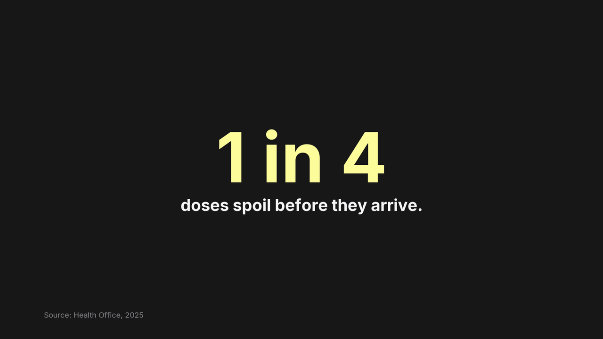
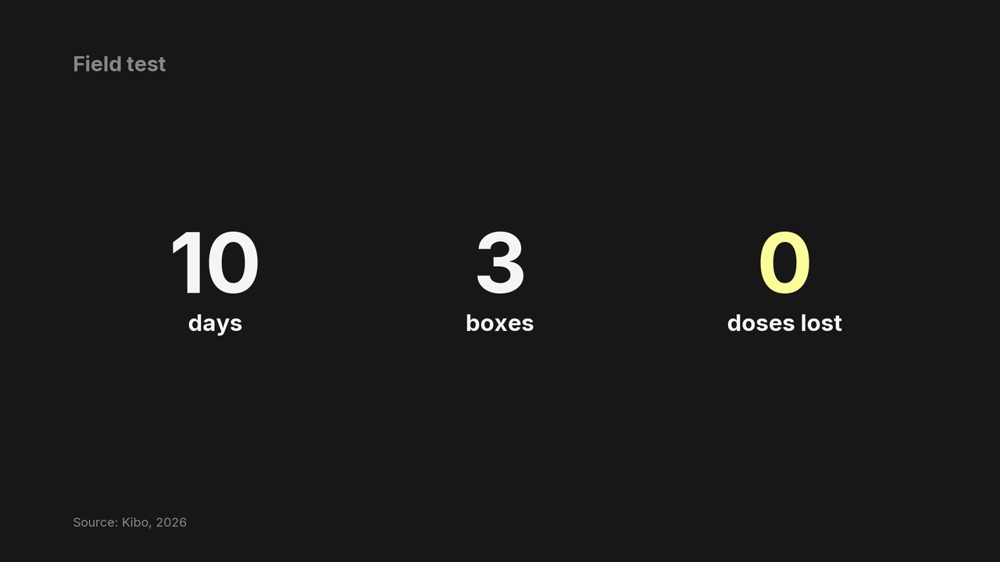
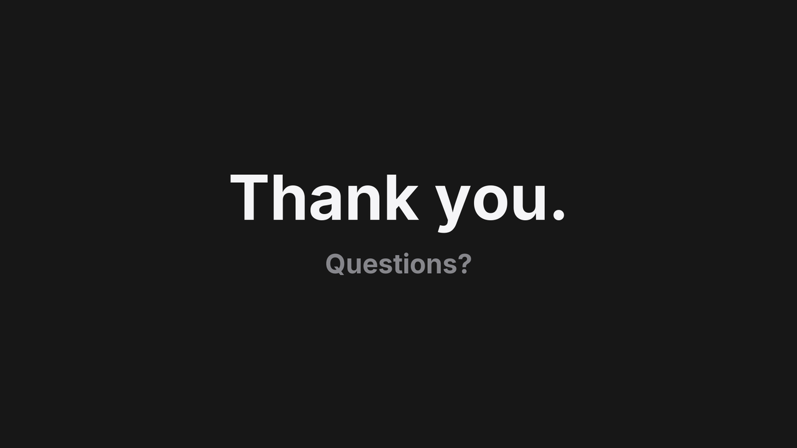

<picture>
  <source media="(prefers-color-scheme: dark)" srcset=".github/assets/banner-dark.svg">
  
</picture>

# Skills for Designing with Agents

[](https://skills.sh/devbyshima/design-skills)

Agent skills for things people look at, starting with slide decks.

Ask an agent for slides and you get bullet points on a template. These skills give it a style to follow, written down as sizes, colours and word counts, and a builder that checks the work and draws a preview, so the agent can see what it made and fix it before you do.

<p>
  
  
  
  
</p>

Slides from the example deck in [one-idea-slides](./skills/slides/one-idea-slides/SKILL.md), as its builder previews them.

[Follow new skills](https://github.com/devbyshima/design-skills/releases)

## Install

```bash
npx skills@latest add devbyshima/design-skills
```

## Why use it?

Taste is hard to hand to an agent. "Make it clean" means nothing to it; "one sentence a slide, 96 px, one accent colour, a source on every number" is something it can follow and check. Each skill here is one taste turned into rules, an example, and a tool that says when the rules are broken.

For skills that keep an agent working for hours, see [devbyshima/skills](https://github.com/devbyshima/skills).

## Reference

- **[one-idea-slides](./skills/slides/one-idea-slides/SKILL.md)**: Write a talk as one JSON file and get a calm, one-idea-a-slide PowerPoint deck with its speaker notes.

[PolyForm Noncommercial 1.0.0](LICENSE): free for non-commercial use.
